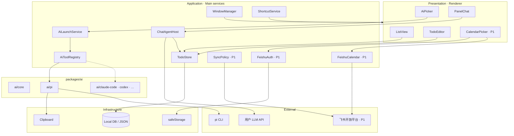
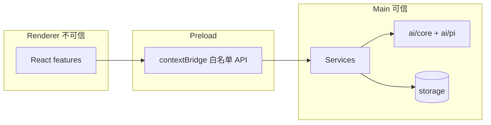
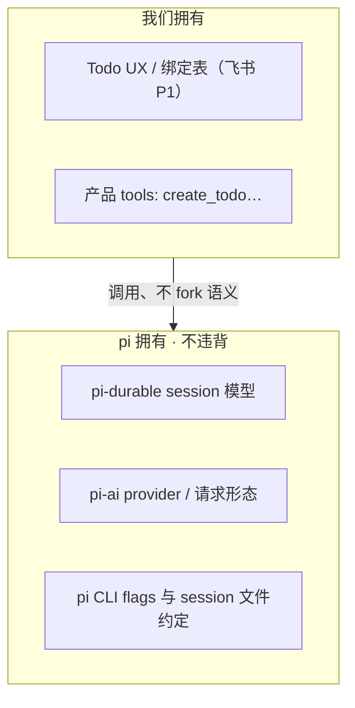
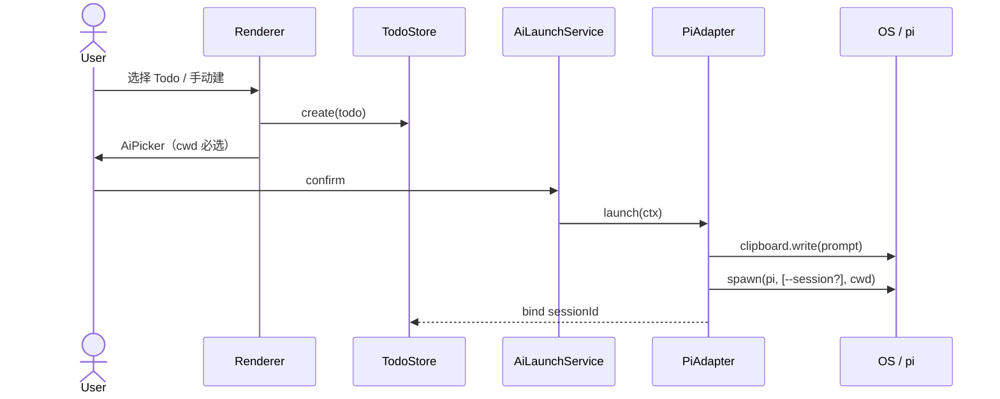
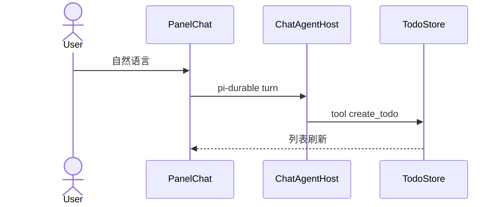

# 技术架构 · Tick 置顶 Todo 工作台

配合 `PRD-tick.md`。会话执行层 = pi；上层产品自研；多 AI 经 `packages/ai/*` Adapter 扩展。飞书相关为 **P1**。

---

## 1. 架构原则

1. **产品在上，pi 在下**：Todo / 拉起编排是我们的（飞书为 P1）；执行与对话语义遵循 pi。
2. **双会话隔离**：面板 `pi-durable` session ≠ CLI `pi --session`；分 ID 存储。
3. **Adapter 扩展**：新 AI 工具 = `packages/ai/<name>`，不改主流程。
4. **可信边界**：OAuth token（P1）、API Key、spawn 只在 Electron Main。
5. **安装 ≠ 业务 CLI**：`scripts/install.sh` 只负责装 App。

---

## 2. 逻辑分层图



> 组合根在 app 层：`ai-host.ts` 实例化 `PiAdapter` 并注入 `ai/core` 的 registry；**`ai/core` 不依赖任何 `ai/<tool>`**（原图 `Core --> PiAd` 已按 as-built 移除）。

---

## 3. 进程与信任边界



---

## 4. 仓库目录（as-built）

```
tick/
├── apps/desktop/                # Electron 唯一应用
│   ├── src/main/                # window · ipc · services（含 todo/session 持久化）
│   ├── src/preload/             # contextBridge 白名单
│   └── src/renderer/features/   # list · editor · ai-picker · panel-chat
├── packages/
│   ├── shared/                  # 类型 + IPC 视图类型
│   ├── ai/
│   │   ├── core/                # Registry · SessionIndex · 投递 · 会话隔离策略
│   │   └── pi/                  # PiAdapter（cwd · clipboard · spawn · resume）
│   └── storage/                 # 可选（未落地）
├── scripts/install.sh           # 发布安装通道（P1）
└── docs/
```

依赖：`apps/desktop` → `shared` / `ai/core` / `ai/pi`；各 `ai/<tool>` → `shared`；禁止反向依赖 app。组合根在 app（`ai-host.ts`）；**`ai/core` 不得依赖具体 `ai/<tool>`**。

---

## 5. 模块职责

| 模块 | 位置 | 职责 |
|------|------|------|
| WindowManager | main | 置顶、显隐（位置记忆待补） |
| ShortcutService | main | 全局快捷键（首版未实现） |
| TodoStore | main | CRUD、软完成（`todo-store.ts`） |
| SessionStore | main | CLI session 持久化（`cli-sessions.json`） |
| ChatAgentHost | main | pi-durable + pi-ai；tools → Todo |
| FeishuAuth / FeishuCalendar | main | OAuth、按日拉日程（**P1**） |
| SyncPolicy | main | 完成≠写回；询问后写回（**P1**） |
| AiToolRegistry | ai/core | detect、列出 adapters |
| AiLaunchService | main | 组装 LaunchContext → adapter |
| PiAdapter | ai/pi | cwd、clipboard、spawn、resume |
| SessionIndex | ai/core | toolId+sessionId+todoId |

---

## 6. AiToolAdapter 合同

```ts
interface AiToolAdapter {
  id: string
  detect(): Promise<boolean>
  capabilities: {
    needsCwd: boolean
    resumeSession: boolean
    deliverPrompt: 'clipboard' | 'flag' | 'stdin' | 'none'
    listSessions: boolean
  }
  launch(ctx: LaunchContext): Promise<LaunchResult>
  resume(sessionId: string, ctx: LaunchContext): Promise<LaunchResult>
}

LaunchResult = { toolId, sessionId, cwd, pid? }
```

pi：`deliverPrompt = clipboard`，`resume` → `pi --session`。

**session id 来源（as-built）**：`launch` 不传 `--session`，让 pi 自己创建 id，随后从 pi 的 session 目录（`~/.pi/agent/sessions/--<encoded-cwd>--/`）读取**最新**文件解析 id。该目录编码为 best-effort 推断，且依赖启动后 settle（当前 `400ms`）——**属已知脆弱点，待换成确定性方案**。

---

## 7. 与 pi 的边界（必须遵守）



- 面板执行层：只通过 pi-durable / pi-ai 公开 API 集成  
- CLI：只使用官方/既有 flags（如 `--session`），cwd 由调用方传入  
- 不把面板 session id 当成 CLI session id

---

## 8. 主路径时序

### 8.1 Todo → pi（飞书来源为 P1）



### 8.2 面板对话建 Todo



---

## 9. 数据存储

- Todo：`userData/todos.json`（版本化 + 原子写）  
- CLI session：`userData/cli-sessions.json`；面板 chat：`userData/panel-chat/*.jsonl`  
- Feishu refresh token（P1）/ LLM keys：`safeStorage`（**首版未实现**）
- pi-durable：按其自身 persistence 约定存放，与 Todo DB 分离，仅存引用

---

## 10. 安全

- Preload 白名单 IPC；Renderer 无 Node  
- 不把 token 打进日志  
- spawn 参数固定可枚举，避免 shell 拼接注入  
- OAuth 用 custom protocol 或 loopback，Main 收码（P1）

---

## 11. 发布

| 阶段 | 方式 |
|------|------|
| Dev | vite-plugin-electron / `pnpm --filter @tick/desktop dev` |
| Prod | electron-builder → `.app`；`install.sh` 下载安装 |

---

## 12. 演进

| Phase | 内容 |
|-------|------|
| P0 | ai/pi only（本地 Todo + 拉起 + 面板对话） |
| P1 | 飞书日历（OAuth / 拉日程 / 点选建 todo / 写回） |
| P2 | Registry UI + 第 2 个 ai/<tool>；SessionIndex 跨工具浏览 |
| P3 | Windows 安装与更多 Adapter |
